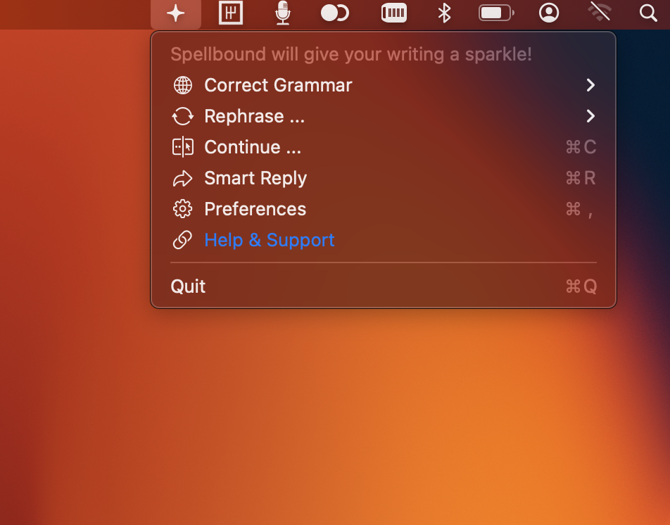
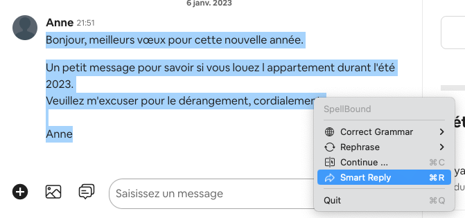
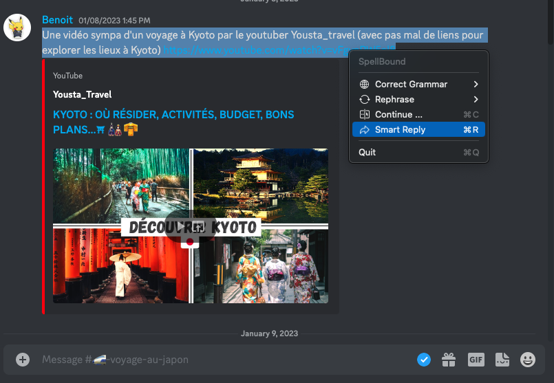

<div align="center">


# SpellBound

**Rewrite any text, anywhere on your Mac, without leaving the app you're in.**

macOS menu bar app · SwiftUI · Powered by your own OpenAI key

</div>

---

## The problem

You write in Slack, Gmail, Notion, your terminal, a Jira ticket. When you want AI help with a sentence, you copy it, switch to ChatGPT, paste, prompt, copy the result, switch back, paste again. Six steps to fix one sentence — every single time.

SpellBound removes the round trip. Select text → hit a shortcut → pick what you want → the text is replaced in place. It works in **every** macOS app, because it drives the system Accessibility API rather than living inside a browser tab.

## What it does

Select text anywhere and press <kbd>⌃</kbd><kbd>⇧</kbd><kbd>⌘</kbd><kbd>I</kbd>:

| | |
|---|---|
| **Grammar Genius** | Fix grammar and spelling in place |
| **Tone Wizard** | Rewrite as formal, casual, concise, poetic, humorous, sarcastic, inspiring… |
| **Continue** | Keep writing from where you stopped |
| **Smart Reply** | Draft a reply to the selected message |



## Why it's different

- **Works everywhere** — Discord, Mail, Xcode, any native or web app. Not a browser extension, not another chat window.
- **Replaces text in place** — no copy-paste dance. The selection is swapped for the result.
- **Your key, your data** — you bring your own OpenAI API key. It's stored in the macOS Keychain and requests go straight from your Mac to OpenAI. There is no middleman server.
- **Menu bar native** — SwiftUI, ~2 MB, launches at login, stays out of the way.





## Build it

Requires macOS 13.1+ and Xcode 14+.

```bash
git clone https://github.com/ne0r0mancer/SpellBoundMenuBarApp.git
cd SpellBoundMenuBarApp
open SpellBoundMenuBar.xcodeproj
```

Set your own signing team in **Signing & Capabilities** (the committed project has it blank), then build and run. Dependencies resolve automatically via SwiftPM:
[KeyboardShortcuts](https://github.com/sindresorhus/KeyboardShortcuts) and
[LaunchAtLogin-Modern](https://github.com/sindresorhus/LaunchAtLogin-Modern).

To package a DMG:

```bash
./create_dmg.sh
```

## Set it up

1. **Add your OpenAI key** — Preferences → paste a key from [platform.openai.com](https://platform.openai.com/api-keys). It's saved to the Keychain, never to disk in plaintext.
2. **Grant Accessibility permission** — System Settings → Privacy & Security → Accessibility. This is how SpellBound reads your selection and types the replacement back. It's required; the app can't work without it.
3. **Pick your shortcut** — defaults to <kbd>⌃</kbd><kbd>⇧</kbd><kbd>⌘</kbd><kbd>I</kbd>.

## Notes for contributors

- `Services/OpenAIConnector.swift` — the OpenAI chat completions call (`gpt-4o-mini`)
- `Services/SuggestService.swift` — every prompt template lives here; add a tone by adding a method
- `Services/AccessilityService.swift` — reads the selection and writes the result back
- `MenuManager.swift` — builds the popup menu
- `Services/GumroadConnector.swift` — Gumroad license verification. Product IDs are read from `Info.plist` (`GumroadMembershipProductID` / `GumroadLifetimeProductID`), which ship empty in this repo — set your own to enable the check.

No secrets live in source. The OpenAI key and the user's license key are both stored in the macOS Keychain (`Services/Keychain.swift`), and prompt/response contents are only logged under `#if DEBUG`, never in Release builds.

## License

MIT — see [LICENSE](LICENSE).
